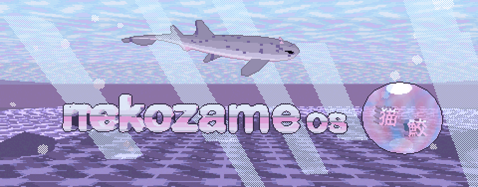

# nekozame os

<p align="center"></p>

opinionated immutable distro, built on [Bazzite](https://bazzite.gg).

## install

from Bazzite (DX, NVIDIA) or any Universal Blue image. your files, Flatpaks and settings stay.

```sh
# drop anything you layered yourself
sudo rpm-ostree reset

# first time: unsigned, then reboot
sudo rpm-ostree rebase ostree-unverified-registry:ghcr.io/purplekairi1312/nekozame-os:latest
systemctl reboot

# then the signed image, then reboot
sudo rpm-ostree rebase ostree-image-signed:docker://ghcr.io/purplekairi1312/nekozame-os:latest
systemctl reboot
```

## faq

**what does nekozame mean?**
猫鮫, catshark. i'm a catgirl, i love cats, sharks are my fav animal, and i'm a Sonic fan: the Sonic hedgehog protein (yes, named after Sonic) gets studied a lot in catsharks, which i find funny.

**going back to Bazzite?**

```sh
sudo rpm-ostree rebase ostree-image-signed:docker://ghcr.io/ublue-os/bazzite-dx-nvidia:stable
```

**how is it built?**
GitHub Actions builds it daily from the [`Containerfile`](Containerfile) and [`build_files/build.sh`](build_files/build.sh), signed with Cosign:

```sh
cosign verify --key cosign.pub ghcr.io/purplekairi1312/nekozame-os
```

## credits

[Bazzite](https://bazzite.gg) and the Universal Blue [image template](https://github.com/ublue-os/image-template).

## license

code: [GPL-3.0-or-later](LICENSE). bits from the Universal Blue template were Apache 2.0.
art (logo, catshark, boot animation, wallpapers): mine, [CC BY-NC-SA 4.0](https://creativecommons.org/licenses/by-nc-sa/4.0/). see [`LICENSE-ART`](LICENSE-ART).
