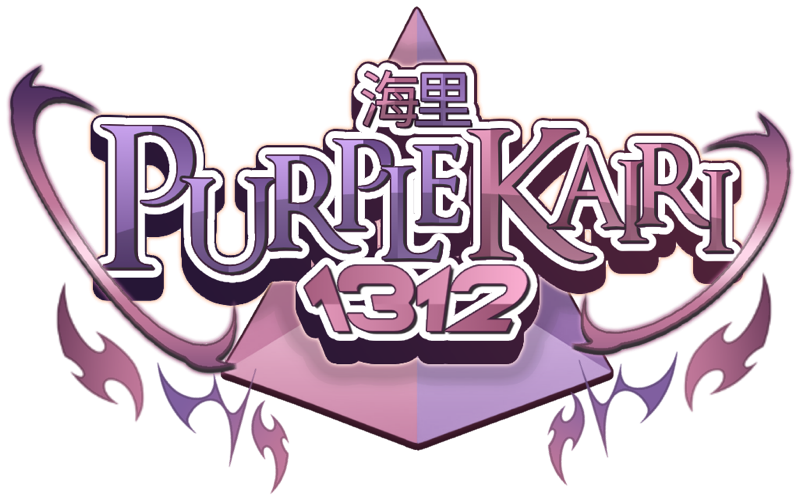

# Nekozame OS

<p align="center"></p>

A pastel [Bazzite](https://bazzite.gg) by purplekairi1312: Bazzite DX with
NVIDIA drivers, plus the [niri](https://github.com/niri-wm/niri) scrolling
window manager, [DankMaterialShell](https://github.com/AvengeMedia/DankMaterialShell)
and the **Mauveine** theme.

*Nekozame* (猫鮫) is Japanese for catshark: a small, gentle shark with
cat-like eyes. Cat plus shark, so a catgirl shark.

Built daily on top of `ghcr.io/ublue-os/bazzite-dx-nvidia:stable`, so it gets
every Bazzite update.

## What's added

| | |
|---|---|
| Desktop | niri and DankMaterialShell, next to Bazzite's KDE Plasma. Choose either on the login screen. |
| Apps | Emacs, Ghostty, fuzzel |
| Look | The Nekozame OS name and logo (fastfetch, About this System, boot menu) |
| Theme | Mauveine color scheme for KDE, a Ghostty theme, a wallpaper and a `.gpl` swatch palette for Krita, GIMP and Aseprite |

## Mauveine

A soft lavender background with pastel pink, baby blue, mint, lemon and lilac.
Dark, but only a little.

| | | | |
|---|---|---|---|
| background `#5a4f6e` | panel `#4f4562` | text `#ffffff` | muted `#e8def5` |
| orchid `#ffc0e5` | pink `#ffd4ee` | baby blue `#b8e4ff` | cyan `#b8f5f2` |
| mint `#c8f7dc` | lemon `#fff1b0` | lilac `#e3ccff` | peach `#ffd2b8` |

Theme files after install:

- KDE: System Settings → Colors → **Mauveine**
- Ghostty: `theme = mauveine`
- Wallpaper: System Settings → Wallpaper → **Mauveine**
- Art palette: `/usr/share/mauveine/mauveine.gpl`

## Switch an existing Bazzite to it

Your files, Flatpaks and settings stay as they are; nothing is reinstalled.

```sh
# 1. drop packages you layered yourself (skip if you never used rpm-ostree install)
sudo rpm-ostree reset

# 2. switch to the image (first time only, unsigned), then reboot
sudo rpm-ostree rebase ostree-unverified-registry:ghcr.io/purplekairi1312/nekozame-os:latest
systemctl reboot

# 3. switch to the signed image, so later updates are verified, then reboot
sudo rpm-ostree rebase ostree-image-signed:docker://ghcr.io/purplekairi1312/nekozame-os:latest
systemctl reboot
```

Updates then arrive like normal Bazzite updates.

To go back to stock Bazzite at any time:

```sh
sudo rpm-ostree rebase ostree-image-signed:docker://ghcr.io/ublue-os/bazzite-dx-nvidia:stable
```

The previous version also stays in the boot menu after every update.

## Building

The image is built by GitHub Actions from [`Containerfile`](Containerfile) and
[`build_files/build.sh`](build_files/build.sh), and signed with cosign.
Verify it with [`cosign.pub`](cosign.pub):

```sh
cosign verify --key cosign.pub ghcr.io/purplekairi1312/nekozame-os
```

Based on the Universal Blue [image template](https://github.com/ublue-os/image-template).
